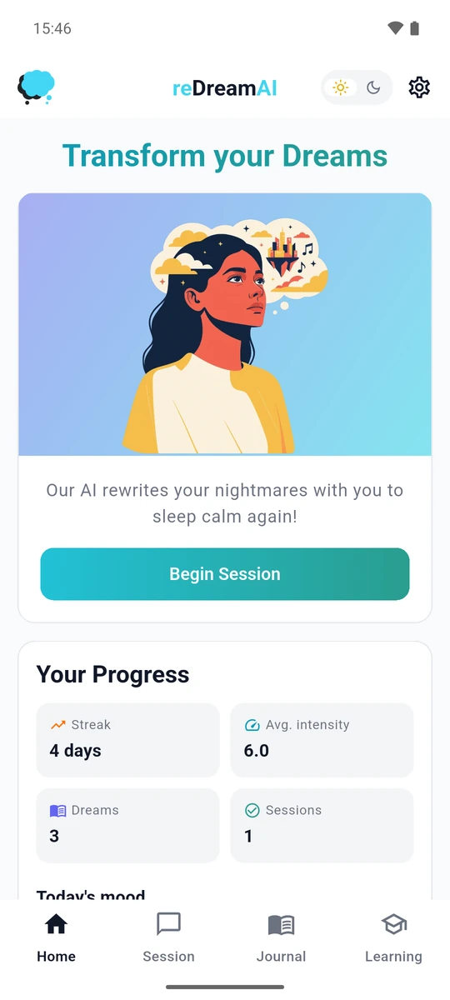
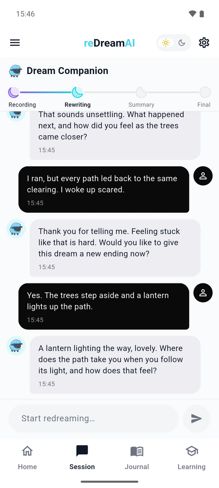
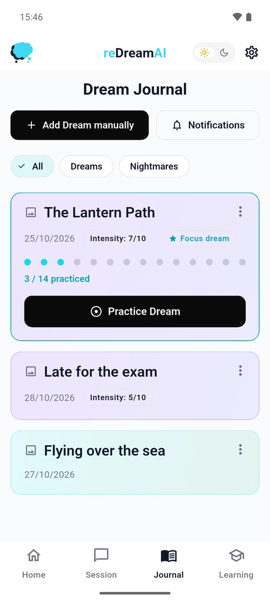
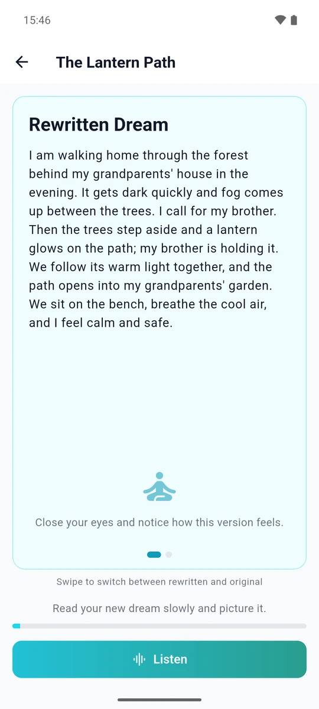

<h1 align="center">reDreamAI</h1>
<br>
<h3 align="center">A self-help companion app against nightmares: record a dream, rewrite it, and rehearse.</h3>

</div>
    
<p align="center">
  
  
  
  
</p>
<p align="center"><sub>Home · Session with the AI guide · Journal · Rewritten dream (example content)</sub></p>

<br>*reDreamAI does not diagnose or treat any condition. If you have PTSD or chronic nightmares, please talk to a doctor or psychotherapist.*<br>

## Repository layout

```
apps/
  ai/        Python FastAPI (stateless): chat, safety classifier, TTS, STT
  api/       Python FastAPI + async SQLAlchemy: source of truth for users, chats, dreams
  app/       Flutter (version pinned in apps/app/.fvmrc): iOS + Android client, EN + DE

supabase/
  migrations/    SQL migrations (managed by Supabase CLI, single Postgres)

infra/
  terraform/            OpenTofu config for the Scaleway box: instance, firewall, runtime key, backup bucket
  bootstrap.sh          One-time setup of that box: Supabase, env files, migrations, stack, backups, trace retention
  docker-compose.yml    Scaleway production topology: caddy + api + ai + langfuse
  caddy/                Reverse proxy config (TLS, SSE-friendly)

docs/
  decisions/    Architecture Decision Records (binding)
```

## Runtime flow

```
Flutter app
   ↓ HTTPS + SSE (Caddy)
apps/api  ← source of truth (chats, dreams, safety events, daily mood)
   ↓ HTTPS
apps/ai   ← stateless: receives full history, returns next IRT stage + response
   ↓
Scaleway Generative APIs (chat, speech-to-text), Mistral (fallback, text-to-speech)
```

## Quickstart (local)

```bash
cp apps/app/.env.example apps/app/.env   # the app bundles .env as an asset; needed before build/test
make help                  # list everything
make ai-dev                # run AI service locally on :8080
make api-dev               # run backend on :8001
make app-run               # flutter run via FVM
make test                  # all test suites
make up                    # full local stack via docker compose
```

## Deploy

One Scaleway instance runs the whole backend. From an empty account to a
working API in three steps: `tofu apply` in `infra/terraform`, copy the repo to
the box, run `infra/bootstrap.sh` there. The steps, what they create and what
ends up public are in [`infra/README.md`](infra/README.md).

## Settings worth knowing

- **Langfuse (diagnostic traces) is off by default.** No chatbot inputs and
  responses are stored as traces, to collect as little personal data as
  possible (GDPR / DSGVO). It can be switched on in `infra/.env` (see
  [`infra/.env.example`](infra/.env.example)) for debugging.
- **Token budgets cap the AI cost.** The backend limits AI tokens per user per
  day, for all users together per day, and for all users together per month.
  A request over a limit is answered with 429 until the limit resets. The
  limits are set in `api.env` (`DAILY_LLM_TOKEN_BUDGET`,
  `DAILY_LLM_TOKEN_BUDGET_TOTAL`, `MONTHLY_LLM_TOKEN_BUDGET_TOTAL`, ADR 0008).

## Decisions

Binding architectural decisions live in [`docs/decisions/`](docs/decisions/README.md). Read those before making structural changes.

Key invariants:
- One Postgres (self-hosted Supabase's). No standalone `db` container.
- AI service is stateless — every request carries the full conversation history.
- Structured outputs (JSON mode) for the summary. No string-matching parsers.
- Self-help framing, never therapy. Disclaimer copy required on user-facing surfaces.
- Crisis detection runs before every IRT turn; high-risk input bypasses the LLM.
- 100k LLM tokens / user / day, 500k / day for all users together (UTC reset).
- Streaming chat end-to-end via SSE.
- Pinned model IDs — no floating aliases (one recorded exception, ADR 0010).

## License

Copyright 2026 Daniel Menzel, Katharina Lüth and Ramon Zacharias. 
Special thanks to our former contributors Mahsa Zand and Tjark Darius who helped to create reDreamAI!

Licensed under the [Apache License 2.0](LICENSE); see [NOTICE](NOTICE).
